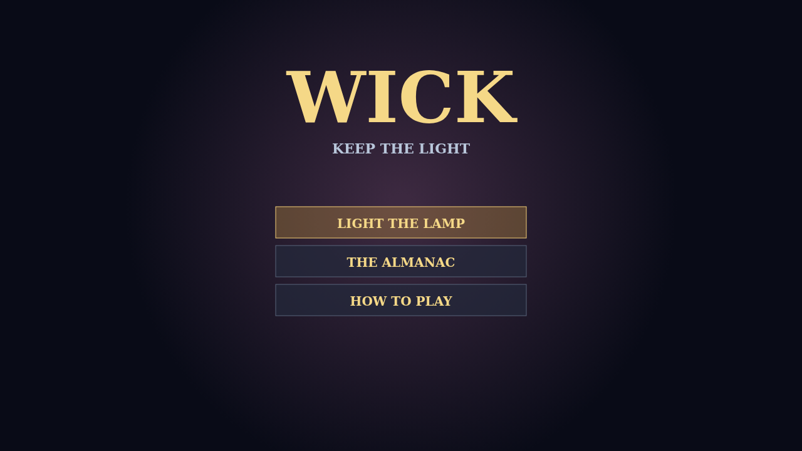

# Carry the flame

Wick is a survival game about one lamplighter in a city that has forgotten the dawn. You only walk; your taper, embers, lanterns, and stranger tools keep their own rhythm while you choose where the circle of light should stand.

The night thickens from the first fragile moths to diving crows, shades, hounds, and finally the Dark itself. Every fallen creature leaves light to gather, and every new level asks which part of your small arsenal should grow.

Elite creatures carry chests. Bring a mastered tool beside its matching trinket and a chest can transform it into something fierce enough to remake the fight.

Keep moving, read the crowd, and make every choice count. Dawn is ten minutes away.

